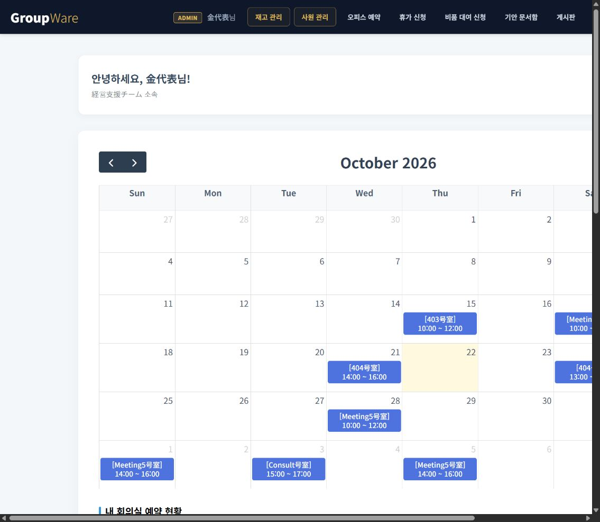
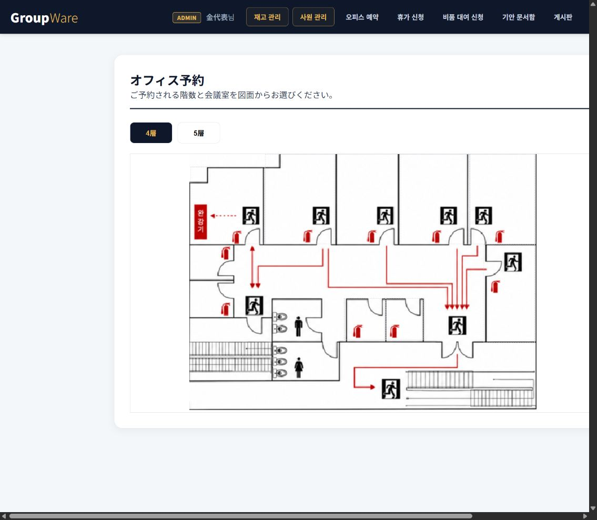

# 검증 기록

검증일: 2026-10-22 (한국 시간)

## 환경

- Windows, Java 17.0.12
- Spring Boot 4.1.1, 내장 Tomcat 11
- Docker 컨테이너 oracle19c / Oracle 19.3.0.0
- localhost:1522 / ORCLPDB1 / 새 전용 계정 GROUPWARE_BOOT

## 검증 항목

- 실제 Oracle 통합 테스트: 재고 초과 신청, 단계별 결재, 반복 반려·반납, 동시 예약, 예약 소유자·만료·비활성 회의실, 연차 최종 승인·롤백, 첨부 메타데이터·댓글·답글
- 비밀번호 테스트: 해시의 무작위 salt, 일치·불일치, 유니코드, 샘플 평문 전환
- HTTP 화면 점검: 대시보드·개인 내역·관리·평면도·예약·대여·휴가·문서함·게시판·주소록·비밀번호 화면, CSS·이미지·스크립트
- 인증 점검: 비로그인 메인 접근, 검증하지 않은 비밀번호 재설정, 토큰 없는 POST
- 브라우저 확인: 로그인, 달력·대시보드, 회의실 평면도

## 최종 결과

| 항목 | 결과 |
|---|---|
| Maven verify와 실행 WAR 생성 | 성공 |
| 비밀번호 단위 테스트 | 2개 통과 |
| 실제 Oracle 통합 테스트 | 9개 통과, 실패·오류 0 |
| main 클래스 직접 실행 | 성공, 주요 경로 34개 정상 |
| 실행형 WAR 실행 | 성공, 주요 경로 34개 정상 |
| 실제 HTTP 기능 흐름 | 25개 통과 |
| Maven Wrapper | Maven 3.9.11 / JDK 17 실행 확인 |
| 원본 CSS·이미지 | 26개 SHA-256 해시 일치 |
| 원본 저장소 | Git 변경 없음 |
| DB 초기화 보호 장치 | 이미 테이블이 있으면 중단 확인 |
| 테스트용 사원 | 검증 후 남은 행 0개 |
| Oracle 객체·잔액 | 무효 객체·음수 연차·비정상 재고 없음 |
| 새 DB 계정 | 지정한 4개 권한, USERS 한도 50MB 확인 |
| Git 제외 | 실제 로컬 비밀번호·업로드·빌드 결과 제외 확인 |

HTTP 흐름에서는 계정 활성화·로그인·권한 차단, 게시글·댓글, 실제 파일 업로드·동일 바이트 다운로드·삭제, 다른 사용자의 수정 차단, 토큰 없는 변경 차단, 검증된 대상만 비밀번호 재설정, 현재 비밀번호 확인, 퇴사 후 기존 세션 차단을 확인했습니다.

IntelliJ 프로그램의 Run 버튼 자체를 자동 조작하지는 않았습니다. 같은 main 클래스를 실제 클래스패스로 직접 실행하고 JSP와 DB 연결을 확인했으며, IntelliJ용 실행 구성과 JDK 17 설정 방법을 제공합니다.

화면의 픽셀 단위 비교와 모든 가능한 입력 조합을 확인한 것은 아닙니다. 원본 화면 자산을 유지하고 주요 정상·오류·동시 요청 흐름을 검증했습니다. 적용·실행한 초기 데이터는 일본어 샘플입니다. 만료된 임시 선점 샘플은 정상 조회 과정에서 정리됩니다.

기계가 읽을 수 있는 결과 요약은 [verification-results.json](verification-results.json)에 있습니다.

## 실행 화면

